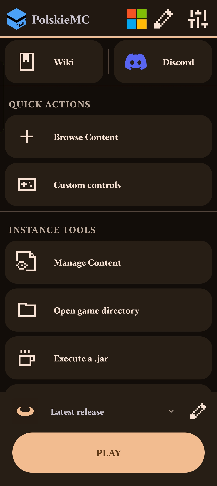
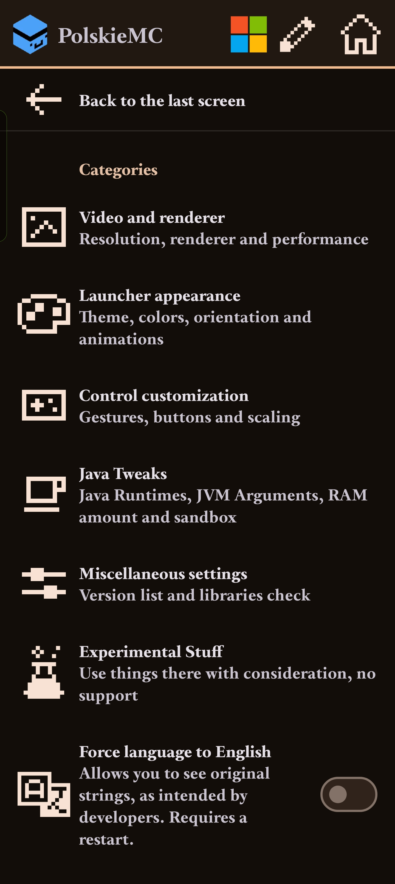
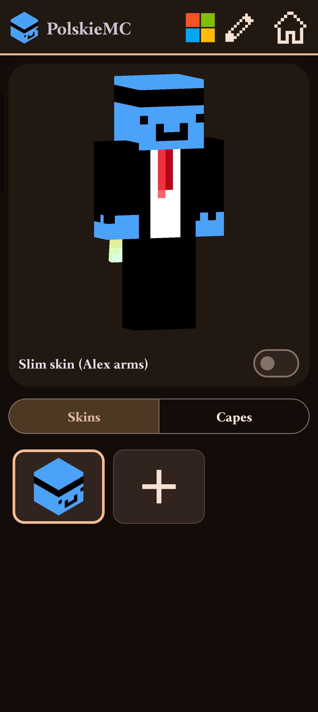
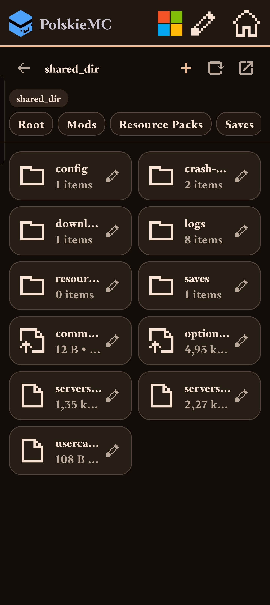

# Libre Launcher (Android)

<p align="center">
  <br>
  <b>A lightweight, open-source Minecraft: Java Edition launcher for Android</b><br>
  <i>Developed by PolskieWin &bull; Powered by Rust native controls and full Minecraft 26.x support</i>
</p>

<p align="center">
  <a href="https://github.com/PolskieWin/libre-launcher/releases"></a>
  <a href="https://github.com/PolskieWin/libre-launcher/releases"></a>
  <a href="https://gitlab.com/fdroid/fdroiddata/-/merge_requests/58168"></a>
  <a href="https://discord.gg/KJpCVzRzRy"></a>
  <a href="https://www.tiktok.com/@librelauncher"></a>
  
</p>

Libre Launcher (Android) is a lightweight, open-source Minecraft: Java Edition launcher for Android (`arm64-v8a`), developed by PolskieWin. Built with native Rust controls, the `LibreMobile` renderer, bundled Java 21 & Java 25 runtimes in a 31 MB stripped APK (without bundled runtime), Modrinth mod/shader integration, and Material You home-screen widgets.

> [!NOTE]
> **Distinction from Desktop PC Launchers**: Libre Launcher (Android) is specifically engineered and optimized for Android mobile devices (`arm64-v8a`). It is an independent project developed by PolskieWin and is completely unrelated to desktop PC launchers or multi-platform desktop clients that share the "LibreLauncher" name.

## Downloads & Links
- **Official Website**: [polskiewin.github.io](https://polskiewin.github.io/)
- **GitHub Repository**: [PolskieWin/libre-launcher](https://github.com/PolskieWin/libre-launcher)
- **GitHub Releases (Official Builds & APKs)**: [PolskieWin/libre-launcher/releases](https://github.com/PolskieWin/libre-launcher/releases)
- **F-Droid Package (Main Catalog Inclusion)**: [F-Droid Merge Request !58168](https://gitlab.com/fdroid/fdroiddata/-/merge_requests/58168)
- **Official Community Discord**: [discord.gg/KJpCVzRzRy](https://discord.gg/KJpCVzRzRy)
- **Official TikTok**: [@librelauncher](https://www.tiktok.com/@librelauncher)

---

## Screenshots

<p align="center">
  
  
  
  
</p>

---

## Roadmap

See [ROADMAP.md](ROADMAP.md) for full version milestones and development plans through v2.40.

## Key Improvements in Libre Launcher

- **100% F-Droid Source Compliance & Zero Blobs**:
  - Full F-Droid main catalog compliance (`!58168`): all native dependencies including `libfreetype.so` are compiled directly from source submodules. Zero prebuilt blobs or proprietary components.
- **OpenJDK 18 + 21 Compatibility on Android 16 (API 36)**:
  - Advanced linker namespace isolation workaround: copies runtime native libraries into the execution namespace with explicit permissions, resolving `clns-9` classloader isolation failures on Android 16.
- **Rust Native Controls (`libre_controls`) & Custom Libre Controlmap**:
  - Brand-new custom Libre Launcher controlmap replacing legacy 2021 layouts with rounded aesthetic controls.
  - Pinpoint 1:1 touch-click accuracy: surface-local coordinates dynamically scaled to active Minecraft framebuffer dimensions across orientation and resolution scaling.
  - Event isolation: virtual controls and buttons fully consume touch events (`return true`), eliminating phantom clicks through to the game canvas.
  - Non-interrupted sprint transitions with diagonal-to-cardinal debounce and EMA aim smoothing.
- **Native Frame Swap Present Hook & Unlocked 120Hz+ Telemetry**:
  - Frame counting directly inside native `eglSwapBuffers` using monotonic `Instant` (`CLOCK_MONOTONIC`) without Android UI `Choreographer` 60 FPS caps.
  - Automatic maximum display refresh rate selection (`preferredDisplayModeId` for 120Hz/144Hz) and unlocked game surface frame rate (`setFrameRate(0f)`).
- **Thermal-Aware Hibernate AFK & Real SoC F3 Info**:
  - Real-time battery and SoC thermal governor dynamically scaling down FPS, surface resolution (0.85x–0.25x), and polling when hot.
  - Pure AMOLED black Hibernate mode (5 FPS) for long AFK sessions.
  - Real SoC model detection (Snapdragon, Dimensity, Tensor, Exynos) in Minecraft F3 debug screen.
- **Minecraft 26.3 & 26.4 Ready**:
  - Full support for 2026 calendar versioning (`26.1`, `26.2`, `26.3`, `26.4`, and `26w...` snapshots).
  - Fixed NeoForge 4-part version resolution (`26.x.y.z`) preventing version parsing crashes.
  - Snapshot comparator contract fix in `ComparableVersionString` preventing TimSort crash bugs.
  - Smart automatic JRE runtime fallback (Java 21/25 LTS for modern 26.x versions).
- **100% Material 3 Copper Architecture**:
  - Consistent Material 3 theme across all launcher activities, dialogs, drawers, and in-game dialogs with zero legacy popups.
- **Native Pre-Boot Mod Compatibility Scanner**:
  - Fast native Rust/JNI analyzer scanning `fabric.mod.json`, `quilt.mod.json`, and bundled ELF native binaries before JVM launch.
  - Automatically identifies duplicate mod IDs, missing dependencies, x86-only native libraries on ARM Android, and renderer conflicts (e.g., Sodium on GL4ES, VulkanMod without Turnip).
  - Clean Material 3 warning dialog with one-tap automatic fix or launch anyway.
- **Direct Pinned Home Screen Shortcuts**:
  - Pin any Minecraft instance directly to the Android home screen for instant one-tap launching.
- **Advanced Custom Driver & Renderer Management**:
  - Direct access to Custom Vulkan Drivers (Turnip / Freedreno) in Video Settings without arbitrary UI hiding.
  - Full renderer suite: GL4ES, Mesa Zink (OpenGL over Vulkan), OpenLTW, ANGLE, VirGL, and plugin renderers.
- **Upcoming Stripped Flavor**:
  - Standalone ultra-lightweight `stripped` APK flavor (~35–45 MB) containing 2 essential renderers (Libre Mobile + GL4ES) and zero bundled runtimes for standalone installation and distribution.

---

## Building

### Android APK Build via Gradle

```bash
# Clone the repository with submodules
git clone --recurse-submodules https://github.com/PolskieWin/libre-launcher.git
cd libre-launcher

# Build Debug APK
./gradlew :app_libre:assembleFullDebug
```

The resulting APK will be located at:
`app_libre/build/outputs/apk/full/debug/app_libre-full-debug.apk`

### Building the Rust Controls Library

```bash
cd libre_controls
cargo build --release
cargo test
```

---

## Credits & Lineage

Libre Launcher is built upon the incredible work of the open-source Minecraft on mobile community:
- **[Copper Launcher](https://github.com/CopperLauncher/Copper-Android)** by MaxJubayerYT
- **[MojoLauncher](https://github.com/MojoLauncher/MojoLauncher)**
- **[Amethyst Launcher](https://github.com/AngelAuraMC/Amethyst-Android)**
- **[PojavLauncher](https://github.com/PojavLauncherTeam/PojavLauncher)**

Licensed under the **GNU Lesser General Public License v3.0 (LGPL-3.0)**.

---

## Legal & Trademarks

**NOT AN OFFICIAL MINECRAFT PRODUCT. NOT APPROVED BY OR ASSOCIATED WITH MOJANG OR MICROSOFT.**

Minecraft is a registered trademark of Mojang AB. Libre Launcher is an independent open-source launcher developed under the LGPL-3.0 license and is not affiliated with, endorsed by, or sponsored by Mojang Studios or Microsoft Corporation. All trademarks belong to their respective owners.
